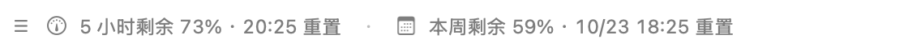
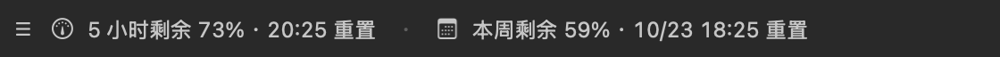

# Codex 额度条 · Codex Quota Bar

一个轻量的 macOS 原生 Codex 额度插件：**查看 5 小时和每周剩余额度、重置时间，并把横条拖到喜欢的位置。**

A small native macOS companion for Codex usage limits, reset times, and a draggable status bar.

[下载安装包](https://github.com/wdkwdk/codex-quota-bar/releases/latest) · [使用说明](#使用) · [源码构建](#从源码构建) · [MIT License](LICENSE)

样式预览（演示数据，不代表实时账户）：




## 下载安装

适用 **macOS 13+，Apple 芯片或 Intel Mac**。需要已经安装并使用 ChatGPT 账户登录 Codex，且账户提供对应额度窗口。**Windows / Linux 暂不支持。**

1. 打开 [Releases](https://github.com/wdkwdk/codex-quota-bar/releases/latest)，下载 `CodexQuotaBar-v0.1.0-macos-universal.zip` 并解压。
2. 双击解压目录里的 `install.command`；也可在终端输入 `sh `（末尾有空格），把目录里的 `scripts/install.sh` 拖进去，再按回车。
3. 安装完成后，打开 Codex，在新聊天中输入 `@`，选择 **Codex 额度条**，发送“启动”。也可执行：

   ```sh
   sh ~/Applications/CodexQuotaBar/plugin/scripts/quota-bar.sh start
   ```

安装包自带 Universal 应用，**不需要 Xcode、Python、.NET 或额外 API Key**。安装位置为 `~/Applications/CodexQuotaBar`；安装器会优先寻找 PATH 上的 Codex CLI，然后寻找 Codex / ChatGPT 桌面应用中内置的 CLI。当前 CLI 需要支持 `codex plugin` 命令，不支持时请更新 Codex。

### 首次打开的 macOS 提示

当前 Release 使用本地临时签名，**尚未经过 Apple Developer ID 签名和公证**。下载后首次启动可能被 macOS 拦截。如果你确认下载来源与校验和正确，可在尝试启动后，按 [Apple 的官方说明](https://support.apple.com/en-au/102445) 进入“系统设置 → 隐私与安全性 → 仍要打开”，仅允许此应用。安装器不会移除隔离属性或关闭 Gatekeeper。

Release 附带 `SHA256SUMS.txt`。把它与 ZIP 放在同一目录，使用以下命令校验：

```sh
shasum -a 256 -c SHA256SUMS.txt
```

## 使用

- **拖动横条**：调整位置，松手后自动保存。
- **右键**：立即刷新，切换左上、右上、左下、底部居中、右下，或退出。
- **单击**：查看剩余额度、进度条、完整重置时间和更新时间。
- 跟随 Codex 窗口移动、缩放；切到其他应用或最小化 Codex 时隐藏。
- 窄窗口优先显示百分比，完整重置时间可在详情中查看。

它是独立悬浮窗，不修改 Codex 的输入框或应用文件。多开窗口时跟随当前最前面的 Codex 窗口。**不会随电脑或 Codex 自动启动**；额度条进程仍在时，重新打开 Codex 会恢复显示。

```sh
sh ~/Applications/CodexQuotaBar/plugin/scripts/quota-bar.sh start
sh ~/Applications/CodexQuotaBar/plugin/scripts/quota-bar.sh stop
sh ~/Applications/CodexQuotaBar/plugin/scripts/quota-bar.sh status
```

## 数据与隐私

使用 [官方 App Server 接口](https://learn.chatgpt.com/docs/app-server)：

1. 启动本机 `codex app-server --stdio`。
2. 完成 `initialize` / `initialized` 握手。
3. 调用 `account/rateLimits/read`，每 60 秒刷新，并接收 `account/rateLimits/updated`。

优先读取 `rateLimitsByLimitId.codex`，按 `windowDurationMins` 区分 300 分钟和 10080 分钟窗口。显示 `100 - usedPercent`；未知窗口显示 `--`。重置时间按 Mac 当前时区显示。断线后自动重连，读取失败时显示错误；超过 3 分钟的数据标为过期。API Key 登录或不提供对应额度的账户不能保证显示这两个窗口。

不读取或复制认证文件，不查询第三方重置网站，不启动模型对话。账户请求由现有 Codex CLI 处理，本程序不向第三方上传数据，也不需要辅助功能或屏幕录制权限。位置保存在 `local.wdk.codex-quota-bar` 偏好设置域；运行状态和额度摘要保存在 `~/Library/Application Support/CodexQuotaBar/status.json`，退出时删除此状态文件。

## 从源码构建

源码构建需要 Xcode Command Line Tools；使用 AppKit / Foundation / CoreGraphics，无第三方应用运行时。测试脚本另外需要 Python 3。

```sh
git clone https://github.com/wdkwdk/codex-quota-bar.git
cd codex-quota-bar
sh scripts/build.sh
sh scripts/test.sh
sh scripts/install.sh
```

源码仓库不包含二进制应用。直接安装 GitHub marketplace 中的技能不会自动编译应用，请使用 Release 安装包或先执行以上构建步骤。

构建包含 Apple 芯片与 Intel 的通用安装包：

```sh
sh scripts/build.sh universal
sh scripts/test.sh
sh scripts/package.sh
```

产物位于 `dist/`。发布包仅包含应用、插件元数据、控制脚本和文档，不包含本机账户、运行状态、构建缓存或认证数据。

当前版本已在 macOS 26.6.2 / Apple 芯片机器运行验证；Intel 版本已交叉编译并验证架构，尚未进行 Intel 真机验证。声明的最低系统版本为 macOS 13，其他系统版本尚未逐一实机验证。

诊断接口（读取一次真实额度后退出，不启动模型任务）：

```sh
"plugin/bin/Codex Quota Bar.app/Contents/MacOS/CodexQuotaBar" --probe
```

## 卸载

先停止，再卸载插件和它的本地来源：

```sh
sh ~/Applications/CodexQuotaBar/plugin/scripts/quota-bar.sh stop
codex plugin remove codex-quota-bar@wdk-local-plugins
codex plugin marketplace remove wdk-local-plugins
```

随后可删除 `~/Applications/CodexQuotaBar`、`~/Library/Application Support/CodexQuotaBar`，并执行 `defaults delete local.wdk.codex-quota-bar` 清除位置偏好。插件 ID 为 `codex-quota-bar@wdk-local-plugins`。

## License

[MIT](LICENSE)。这是社区项目，与 OpenAI 无隶属关系。
